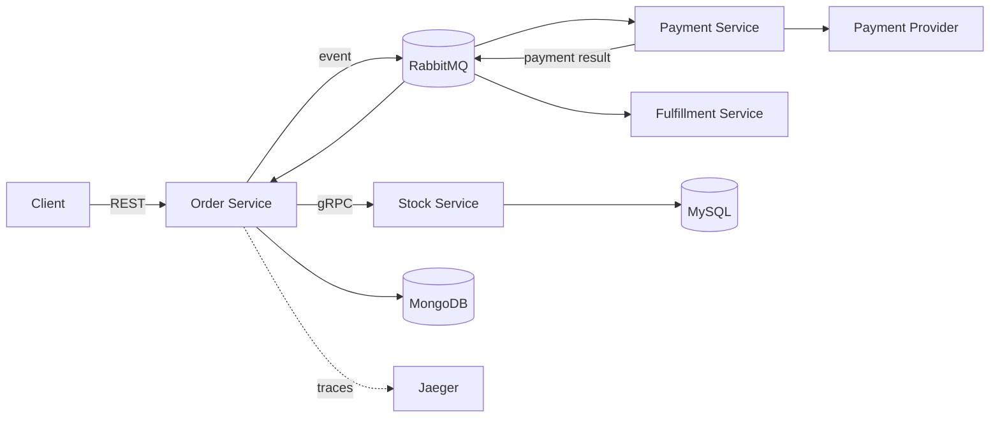

# GOrder

GOrder 是一个使用 Go 构建的订单、库存、支付与履约服务示例。项目来自对真实交易系统
问题的脱敏重建，重点不是补齐商城功能，而是用代码和测试说明：在数据库、消息队列和
外部支付平台无法共享事务时，怎样守住业务状态的一致性边界。

> 项目状态：可验证的工程作品，不是生产系统源码。当前已经闭环的是显式订单状态迁移、
> 支付消息重复投递下的订单终态幂等，以及 Payment、Order、Kitchen 三个 consumer 的单一
> 确认终态与 webhook 发布失败反馈；Outbox、通用 Inbox、publisher confirms 和库存预占仍是
> 明确保留的演进项。

## 核心问题

- RabbitMQ 至少一次投递导致支付成功消息重复到达；
- 消费者在数据库提交后、ACK 前退出，Broker 会重新投递；
- 并发或乱序事件不能把订单从终态覆盖回旧状态；
- MongoDB、MySQL、RabbitMQ 和支付平台之间不存在一个全局事务。

当前实现把订单状态迁移的正确性放在持久化层：`pending -> waiting_for_payment -> paid ->
ready` 的三条迁移都使用带旧状态的原子条件更新，精确重放返回成功 no-op。Stripe Checkout
使用订单 ID 作为幂等键。一条 delivery 只会进入 ACK 或 NACK 其中一条路径；下游处理失败时，
retry/DLQ 交接成功才 ACK 原消息，交接失败则 NACK 并请求 requeue。这个规则避免当前进程
主动丢弃唯一副本，但没有 publisher confirms，不能据此宣称端到端零丢失。

## 架构



| 服务 | 责任 | 主要接口/存储 |
|---|---|---|
| Order | 创建、查询和推进订单状态 | REST、gRPC、MongoDB |
| Stock | 校验商品与库存 | gRPC、MySQL |
| Payment | 创建支付并接收支付结果 | REST、支付 Provider、RabbitMQ |
| Kitchen | 消费订单事件并触发履约 | RabbitMQ、Order gRPC |

服务发现、链路追踪和本地基础设施分别使用 Consul、OpenTelemetry/Jaeger 与 Docker
Compose。它们是项目骨架的一部分，不代表所有生产级治理能力已经完成。

## 可复现验证

环境要求：Go 1.23+。核心验证不需要启动 MongoDB、RabbitMQ、Stripe 或其他外部服务。

```bash
make verify
```

该命令会：

- 编译并测试 Common、Payment、Stock 和 Kitchen 模块；
- 对支付重投涉及的 Order 包运行测试与 race detector；
- 验证首次支付、重复投递、并发重放、租户隔离和三个 consumer 的 ACK/NACK 互斥；
- 验证显式支付会话挂接、ready 迁移、gRPC 错误分类与 Stripe 幂等键；
- 使用真实 Stripe 测试签名验证 webhook 发布成功、发布失败和非法签名分支。

详细实验说明见[支付消息重复投递：原子状态迁移与 ACK/NACK 互斥](docs/experiments/payment-redelivery.md)、
[Consumer correctness：单一确认终态与 webhook 发布反馈](docs/experiments/consumer-correctness.md)和
[显式订单迁移实验](docs/experiments/explicit-order-transitions.md)。

`internal/order/tests` 中另有一个需要完整本地服务的历史端到端测试，因此不属于默认的
离线验证集合。

## 深入阅读

- [文档地图](docs/README.md)：按招聘浏览、架构讨论和本地验证选择阅读路径；
- [系统架构总览](docs/architecture/overview.md)：服务职责、协议边界和运行拓扑；
- [核心业务流程](docs/architecture/business-flow.md)：下单、支付和履约时序；
- [数据所有权与状态模型](docs/architecture/data-and-state.md)：状态权威与迁移约束；
- [可靠性模型](docs/architecture/reliability.md)：当前不变量、证据和失败窗口；
- [架构演进路线](docs/architecture/evolution.md)：Inbox、Outbox、库存预占和对账如何分阶段落地；
- [本地开发指南](docs/development/local-development.md)：环境、启动、验证和排障；
- [证据与公开边界](docs/project-evidence.md)：区分源码事实、已验证行为、缺口和方案。

## 本地基础设施

如需继续调试完整服务，可先启动依赖：

```bash
docker compose up -d
```

Compose 提供 MongoDB、MySQL、RabbitMQ、Consul、Jaeger、Prometheus 和 Grafana，不包含
四个业务进程或 Redis。配置文件中的账号密码仅为本地开发默认值；Stripe 凭据必须通过
环境变量提供，不得提交真实密钥：

```bash
export STRIPE_KEY=replace-with-a-test-key
export ENDPOINT_STRIPE_SECRET=replace-with-a-test-webhook-secret
```

基础设施启动、四个业务进程的顺序、测试数据准备和已知限制见
[本地开发指南](docs/development/local-development.md)。

## 目录

```text
api/                 OpenAPI 与 protobuf 契约
internal/common/     配置、消息、服务发现、日志与 tracing
internal/order/      订单领域、应用层、MongoDB adapter 与消费者
internal/stock/      库存领域、MySQL adapter 与 gRPC server
internal/payment/    支付应用、Provider adapter 与 webhook
internal/kitchen/    履约消费者
docs/experiments/    可复现的故障场景与证据边界
```

## 已实现与未实现

| 能力 | 当前状态 |
|---|---|
| `pending -> waiting_for_payment -> paid -> ready` 显式迁移 | 已实现；首次迁移、重放、冲突与 gRPC 错误分类有测试 |
| Stripe Checkout 按订单 ID 幂等创建 | 已实现参数验证；仍不等于本地支付 ledger 或长期对账 |
| 订单支付终态原子迁移 | 已实现并有单元/并发测试 |
| 重复支付消息成为 no-op | 已实现并有顺序、并发重放测试 |
| Payment、Order、Kitchen ACK/NACK 路径互斥 | 已实现并有成功、非法消息和 retry 错误路径测试 |
| Payment command 下游错误传播 | 已实现；nil order、Stripe error 和 Order gRPC error 有测试 |
| Stripe webhook publish 失败反馈 | 已实现；publish error 返回 HTTP 503，成功才返回 200 |
| 服务骨架与本地基础设施 | 已实现；支持继续调试，不宣称生产就绪 |
| RabbitMQ publisher confirms | 未实现；publish 返回 nil 不等于 Broker 已持久化 |
| 稳定 Provider event ID + 持久化 Inbox | 未实现 |
| 订单落库与发消息的 Transactional Outbox | 未实现 |
| 库存预占、确认、释放和超时回收 | 未实现 |
| 支付、订单、库存自动对账 | 未实现 |

这些边界是项目的一部分：目标是展示可验证的技术判断，而不是把未完成的设计写成现有
能力。

## 来源与公开边界

GOrder 是个人脱敏重建仓库，不包含原任职公司的生产源码、业务数据、内部配置或 Git
历史。工作经历用于说明问题背景；本仓库代码与测试用于证明当前个人实现，两者不混写。
