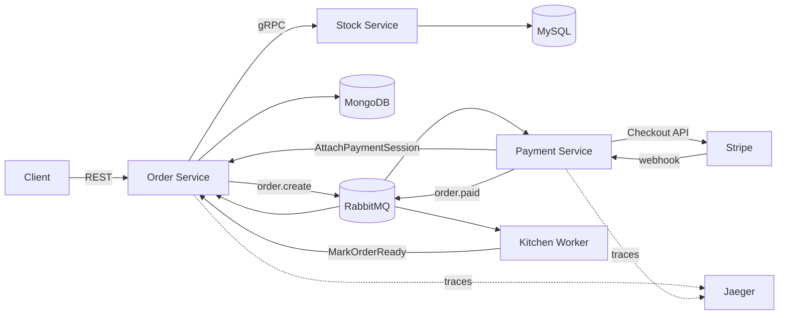
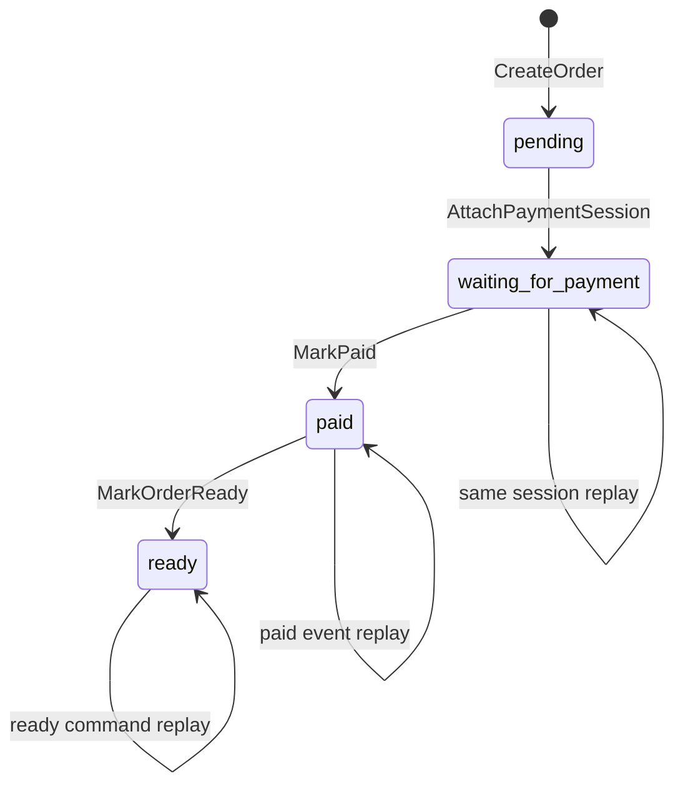

# GOrder

[](https://github.com/jiahuipaung/gorder/actions/workflows/verify.yml)

> Reliable order workflow in Go — explicit state transitions, idempotent payment handling, and testable failure semantics.

面向交易一致性问题的 Go 微服务项目，覆盖订单创建、库存校验、支付会话、支付回调与履约推进。

GOrder 关注的不是商城功能堆叠，而是一个更具体的工程问题：当 MongoDB、MySQL、RabbitMQ
和外部支付平台无法共享事务时，如何让订单状态在重复消息、并发更新和局部失败下仍然保持
可解释、可重入、可验证。

## 项目亮点

- **显式状态机**：订单按 `pending -> waiting_for_payment -> paid -> ready` 推进，跨服务写入
  收敛为 `AttachPaymentSession`、`MarkPaid` 和 `MarkOrderReady`，不暴露任意状态覆盖接口。
- **数据库级幂等**：MongoDB 条件更新同时校验订单、客户和预期旧状态；首次执行推进状态，
  精确重放返回成功 no-op，冲突或乱序更新被拒绝。
- **支付请求幂等**：Stripe Checkout 使用订单 ID 作为幂等键，降低 Payment 消息重投时
  重复创建支付会话的风险。
- **明确的消息确认语义**：Payment、Order、Kitchen consumer 的每条处理路径只选择一个
  ACK/NACK 终态；替代消息发布失败时保留原 delivery。
- **可复现的可靠性证据**：仓库包含并发重放、状态冲突、gRPC 错误分类、webhook 签名与
  发布失败等测试，并在关键 Order 包启用 race detector。

## 架构



| 服务 | 核心职责 | 技术边界 |
|---|---|---|
| Order | 创建、查询订单并维护状态机 | REST、gRPC、MongoDB、RabbitMQ |
| Stock | 校验商品与当前库存 | gRPC、MySQL、Stripe Product API |
| Payment | 创建 Checkout Session、接收并验证 webhook | Stripe、RabbitMQ、Order gRPC |
| Kitchen | 消费支付成功事件并模拟履约 | RabbitMQ、Order gRPC |

服务发现使用 Consul，链路追踪基于 OpenTelemetry 与 Jaeger。本地依赖由 Docker Compose
统一编排。

## 核心状态与可靠性设计



| 场景 | 处理方式 |
|---|---|
| Payment delivery 重投 | Stripe 请求复用订单 ID 幂等键；相同支付链接挂接为 no-op |
| `order.paid` 重复或并发到达 | `status=waiting_for_payment` 条件更新，只有一个调用完成真实迁移 |
| 乱序或冲突状态写入 | 返回非法迁移，不覆盖当前状态或已有支付链接 |
| handler/downstream 失败 | retry/DLQ 交接成功后 ACK 原消息；交接失败则 NACK 并 requeue |
| webhook 发布 RabbitMQ 失败 | 返回 HTTP 503，让支付平台保留重试机会 |
| 格式错误或明确不可处理的消息 | NACK 且不 requeue，避免无意义热循环 |

这里追求的是“至少一次投递下，已建模的业务效果可重入”，而不是用 exactly-once 掩盖跨系统
失败窗口。更完整的故障分析见[可靠性模型](docs/architecture/reliability.md)。

## 快速验证

环境要求：Go 1.23+。

```bash
git clone https://github.com/jiahuipaung/gorder.git
cd gorder
make verify
```

核心验证不需要启动 MongoDB、MySQL、RabbitMQ 或 Stripe。`make verify` 会：

- 编译并测试 Common、Order、Stock、Payment 和 Kitchen 模块；
- 在 Order repository、command、consumer 和 gRPC 端口上运行 race detector；
- 验证状态首次迁移、精确重放、并发支付事件、客户隔离和错误分类；
- 验证三个 consumer 的 ACK/NACK 互斥及 retry 交接失败路径；
- 验证 Stripe 幂等参数、webhook 测试签名和消息发布失败反馈。

GitHub Actions 对每次 push 和 pull request 执行相同验证。

## 测试证据

| 行为 | 对应测试 |
|---|---|
| MongoDB 条件更新包含预期旧状态 | [Mongo repository tests](internal/order/adapters/order_mongo_repository_test.go) |
| 顺序/并发支付重放只推进一次 | [in-memory repository tests](internal/order/adapters/order_inmem_repository_test.go) |
| 显式 command 的验证与重放语义 | [Order command tests](internal/order/app/command) |
| gRPC 参数校验与错误码映射 | [Order gRPC tests](internal/order/ports/grpc_test.go) |
| Consumer 单一 ACK/NACK 终态 | [Payment](internal/payment/infrastructure/consumer/consumer_test.go) · [Order](internal/order/infrastructure/consumer/consumer_test.go) · [Kitchen](internal/kitchen/infrastructure/consumer/consumer_test.go) |
| Stripe webhook 与发布失败 | [Payment HTTP tests](internal/payment/http_test.go) |
| Checkout Session 稳定幂等键 | [Stripe processor tests](internal/payment/infrastructure/processor/stripe_test.go) |

## 本地运行

启动 MongoDB、MySQL、RabbitMQ、Consul、Jaeger、Prometheus 和 Grafana：

```bash
docker compose up -d
```

Compose 负责基础设施，四个业务进程需要分别启动。涉及支付的本地调试只应使用 Stripe test
mode，并通过环境变量提供测试凭据：

```bash
export STRIPE_KEY=replace-with-a-test-key
export ENDPOINT_STRIPE_SECRET=replace-with-a-test-webhook-secret
```

完整启动顺序、测试数据和排障方式见[本地开发指南](docs/development/local-development.md)。

## 目录结构

```text
api/                 OpenAPI 与 protobuf 契约
internal/common/     消息、服务发现、日志、指标与 tracing
internal/order/      订单领域、应用命令、MongoDB adapter 与 consumer
internal/stock/      库存查询、MySQL adapter 与 gRPC server
internal/payment/    支付应用、Stripe adapter、webhook 与 consumer
internal/kitchen/    履约 consumer 与 Order gRPC adapter
docs/                架构、可靠性、演进设计与复现实验
```

## 深入阅读

- [系统架构总览](docs/architecture/overview.md)：服务职责、协议边界与运行拓扑；
- [核心业务流程](docs/architecture/business-flow.md)：从创建订单到支付、履约的完整时序；
- [数据所有权与状态模型](docs/architecture/data-and-state.md)：状态权威与迁移约束；
- [可靠性模型](docs/architecture/reliability.md)：消息语义、失败窗口和当前保证；
- [架构演进路线](docs/architecture/evolution.md)：Inbox、Outbox、库存预占与对账设计；
- [可复现实验](docs/README.md#本地验证与继续开发)：支付重放、consumer correctness 和显式迁移；
- [证据与公开边界](docs/project-evidence.md)：源码事实、验证结果与演进设计的区分。

## 演进方向

- 为支付事件引入稳定 event envelope、Provider event ledger 与 consumer Inbox；
- 使用 Transactional Outbox 和 publisher confirms 关闭数据库提交与消息发布之间的窗口；
- 将库存检查演进为可重入的预占、确认、释放状态机；
- 为履约副作用增加持久化执行记录，并补充跨服务对账与故障注入实验。

## 项目来源

GOrder 是基于交易系统问题域进行的个人独立、完全脱敏重建。仓库不包含任何原公司的生产
源码、业务数据、内部配置或 Git 历史；当前实现、测试与文档均以本仓库为准。
