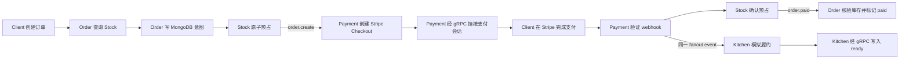
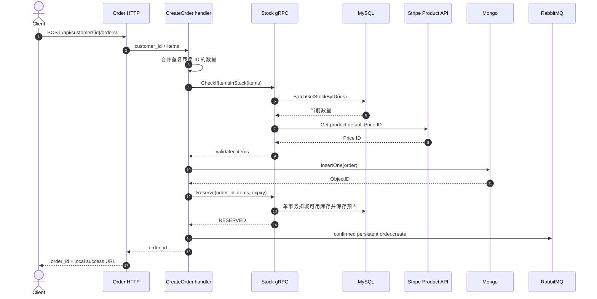
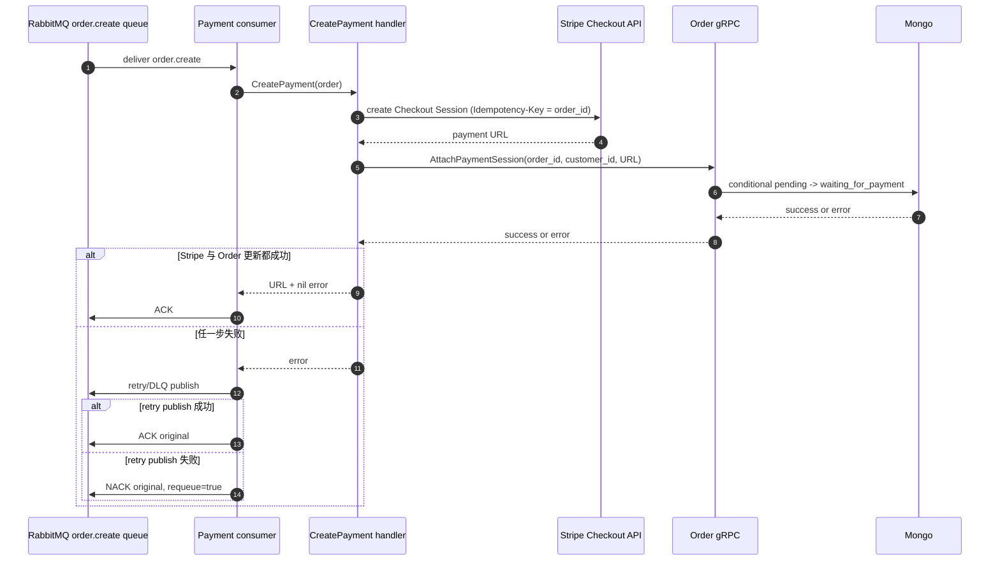
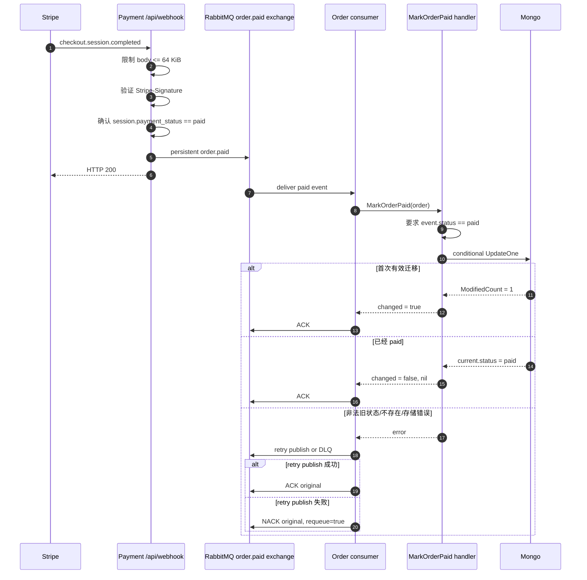
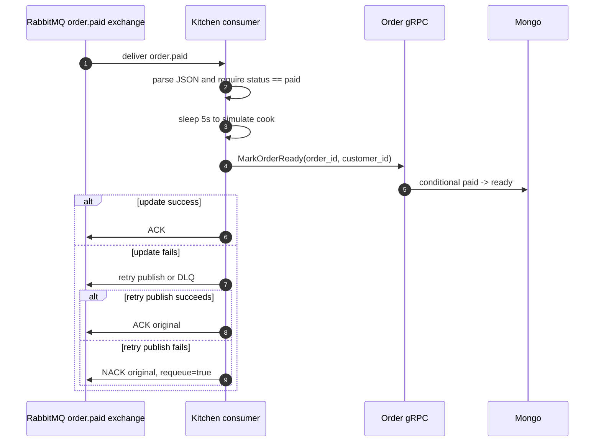

# 核心业务流程

[返回文档地图](../README.md) · [系统架构总览](overview.md) ·
[数据所有权与状态模型](data-and-state.md)

本文沿着当前代码实际执行路径，说明创建订单、创建支付、处理支付结果和模拟履约四段流程。
每段都把成功路径与直接可见的失败窗口放在一起，避免“流程图能走通”等同于“异常已经
闭环”。

## 1. 总体事件链



这条链路没有跨 MongoDB、MySQL、RabbitMQ 与 Stripe 的全局事务。Order 当前用条件更新约束
`pending -> waiting_for_payment -> paid -> ready`，明确缺货时进入 `stock_rejected`。
库存预占与订单写入仍是跨系统步骤，履约副作用也没有持久去重记录。

## 2. 创建订单

### 2.1 当前成功路径



具体步骤：

1. HTTP handler 解析请求，把客户 ID 和商品数量交给 `CreateOrder`；
2. `packItems` 按商品 ID 合并重复项；
3. Order 同步调用 Stock 的 `CheckIfItemsInStock`；
4. Stock 从 MySQL 读取当前数量，逐项比较请求数量；
5. Stock 再从 Stripe Product API 获取默认 Price ID，返回用于支付的商品快照；
6. Order 以 `pending` 初始状态插入 MongoDB，使用 MongoDB ObjectID 的十六进制字符串作为公开订单 ID；
7. Order 以该 ID 调用 Stock `Reserve`；多 SKU 在同一 MySQL 事务中预占；
8. Order 将完整订单 JSON 作为持久化 `order.create` 消息发布到同名队列，等待 Broker confirm；
9. HTTP 返回订单 ID 和本地成功页 URL。暂时性下游错误时也会返回待恢复的订单 ID。

### 2.2 当前语义边界

- 初次检查只做前置校验；最终以 MySQL 原子 Reserve 判定可用库存，失败不会部分扣减；
- 新插入订单显式处于 `pending`，只有挂接非空支付链接后才能进入 `waiting_for_payment`；
- Stock 获取任一 Price ID 失败时会让整个订单校验失败，不返回部分商品；
- HTTP 创建入口要求路径和请求体中的 `customer_id` 一致。

### 2.3 失败窗口

| 位置 | 当前结果 | 风险 |
|---|---|---|
| Stock/MySQL/Stripe 调用失败 | 创建订单返回错误 | 没有订单落库；客户端可重试，但没有请求幂等键 |
| MongoDB 写入失败 | 不发布消息，创建失败 | 结果清晰 |
| MongoDB 写入成功，预占/发布暂时失败 | 返回仍为 `pending` 的订单 ID；后台以同一 ID 重试 | 客户端若丢失响应并重试，仍可能创建第二笔订单 |
| 消息发布成功，响应返回前进程退出 | 客户端可能认为失败 | 重试可能创建重复订单；没有创建请求去重记录 |

MongoDB 插入、MySQL Reserve 和 RabbitMQ 发布仍是独立操作；后台扫描未到期、未发布的
持久意图提供有限恢复，不等于 Transactional Outbox。到期订单不会自动释放，需先核查支付。

## 3. 创建支付链接

### 3.1 当前成功路径



Stripe Checkout Session metadata 保存 `orderID`、`customerID`、商品 JSON、创建会话时看到的状态
和支付链接字段，用于 webhook 阶段还原订单引用。请求以稳定的订单 ID 作为 Stripe
`Idempotency-Key`。创建出 URL 后，Payment 通过 Order gRPC 的 `AttachPaymentSession` 提交：

```text
status = waiting_for_payment
payment_link = Stripe Checkout URL
```

### 3.2 Consumer 当前确认语义

Payment consumer 已把每条 delivery 收敛为一个显式终态：

- JSON 解析失败：`Nack(requeue=false)` 后立即返回；
- `CreatePayment` 成功：ACK；
- command 失败且 retry/DLQ publish 成功：ACK 原 delivery，由替代消息接管；
- command 失败且 retry/DLQ publish 失败：`Nack(requeue=true)`，保留原 delivery。

`CreatePayment` 对 nil order 立即返回错误，Stripe error 与 Order gRPC error 都会继续返回给
consumer，不再把“支付会话已创建但订单链接回写失败”误报为成功。重试交接使用 Broker
confirm 与 mandatory 路由检查；这仍不替代业务库与消息的原子提交。

### 3.3 其他失败窗口

| 位置 | 当前结果 | 风险 |
|---|---|---|
| Stripe 已创建 Checkout Session，Order gRPC 回写失败 | error 到达 consumer，并进入 retry/DLQ 交接 | 同一订单重试使用同一幂等键；仍缺少本地 Payment ledger 与 Provider 对账 |
| Payment 在 gRPC 成功后、ACK 前退出 | Broker 重投 | Stripe 返回同一幂等请求结果；Order 对同链接重放返回成功 no-op |
| 挂接请求携带不同链接或旧状态不为 `pending` | 条件更新不命中并读取分类 | 拒绝覆盖并返回 `FailedPrecondition`，由现有 retry/DLQ 路径处理 |
| Stripe metadata 构造 | 使用创建 Checkout 前收到的订单字段 | metadata 中 `paymentLink` 是旧值，通常为空 |

## 4. 支付成功与订单终态迁移

### 4.1 Webhook 接收与事件发布



持久化层的条件是：

```text
_id = order_id
customer_id = event.customer_id
status = waiting_for_payment
```

只在条件命中时设置 `status=paid`；event 携带的 `payment_link` 非空时才更新该字段，空值
会保留 Order 已保存的链接。若没有修改，repository 重新读取订单：当前已经是 `paid` 时返回
成功 no-op，其他状态返回非法迁移错误。

### 4.2 已验证的范围

- 首次 `waiting_for_payment -> paid` 返回一次真实变化；
- 顺序重复投递返回成功 no-op；
- 并发重放只有一个调用观察到真实变化，并在 race detector 下运行；
- `order_id + customer_id` 一起限制更新目标；
- Order consumer 成功只 ACK，解析失败或 event status 非 `paid` 时只 NACK；handler 失败后
  根据 retry 交接结果 ACK 或 requeue NACK，且每条路径只有一个确认调用。

可复现命令和测试范围见[支付消息重复投递实验](../experiments/payment-redelivery.md)。

### 4.3 Webhook 与事件缺口

| 位置 | 当前结果 | 风险 |
|---|---|---|
| Stripe event ID | 未写入 `order.paid` 消息，也没有持久化 Inbox | 只能依赖状态迁移吸收这一种重复副作用，不能审计每个 Provider event |
| RabbitMQ publish 返回错误 | webhook 返回 HTTP 503 | 允许 Stripe 按 Provider 策略重试；但没有本地 event ledger/Outbox，恢复仍依赖外部重试 |
| Broker 已确认消息但业务库更新未原子提交 | 当前没有 Outbox/Provider event ledger | 跨系统仍需对账；confirm 只证明 Broker 接收 |
| metadata `paymentLink` | 来自创建会话前的订单快照 | 空值不会再覆盖本地链接；非空旧快照仍可能回退较新的链接，P1 应从事件契约移除该权威 |
| metadata 商品 JSON | 当前序列化订单商品快照，再还原为 order protobuf item | 大订单受 Stripe metadata 大小限制；无 Provider event ledger |
| 其他 Stripe event type / 未 paid session | 返回 HTTP 200，不发布业务事件 | 这是当前筛选策略，不是完整支付状态机 |

## 5. 模拟履约



Kitchen 是演示性的履约 worker，不代表真实仓储、发货或制作系统。

当前缺口：

- `cook` 是不可追踪的五秒 sleep，没有独立履约记录或幂等键；
- 若执行完 `cook` 后、Order gRPC 成功前后发生重投，模拟副作用会再次执行；
- `MarkOrderReady` 要求旧状态为 `paid`；首次更新原子写入 `ready`，精确重放成功 no-op；
- `ready` 已成为 Order domain 的显式状态，但没有拆分制作中、失败、取消等更细履约状态；
- JSON 解析失败或状态不是 `paid` 时只执行一次 `Nack(requeue=false)`，不会 cook 或调用 gRPC；
- Order gRPC 失败后，retry 交接成功 ACK 原 delivery，交接失败 NACK 并 requeue；这修复了确认
  控制流，但不解决 `cook` 已经发生后的副作用重复；
- Kitchen 使用 server-named fanout queue，运行期行为依赖 RabbitMQ 声明与绑定成功。

## 6. 跨流程不变量

当前代码能够明确表达或验证的不变量只有一部分：

| 不变量 | 当前机制 | 证据状态 |
|---|---|---|
| 支付终态只能从 `waiting_for_payment` 首次迁移到 `paid` | MongoDB 条件更新 | 已验证 |
| 支付会话只能从 `pending` 首次挂接，冲突链接不能覆盖 | MongoDB 条件更新与重放分类 | 已验证 |
| ready 只能从 `paid` 首次迁移，重复 ready 为 no-op | MongoDB 条件更新与重放分类 | 已验证 |
| 同一支付消息重投不会重复改变订单终态 | 已支付时成功 no-op | 已验证 |
| 支付事件不能更新另一客户的同 ID 订单 | `_id + customer_id` 条件 | 已验证 |
| Payment、Order、Kitchen 一次 delivery 只 ACK 或 NACK | 显式分支与错误路径立即返回 | 已验证 |
| 创建订单后一定启动支付 | 到期前扫描持久意图并重试 | 非原子承诺；到期和响应丢失仍需处理 |
| 库存并发不会重复卖出同一件 | MySQL 原子 Reserve | 已覆盖最后一件并发测试；不保证完整支付履约 |
| Provider 已支付一定反映到订单 | Confirm 后发布失败返回 503 | 无本地 ledger/Outbox/对账，仍不成立 |
| 履约副作用只执行一次 | 无履约 Inbox/记录 | 不成立 |

这些不变量和失败窗口会在[可靠性模型](reliability.md)中进一步按“机制—证据—剩余风险”
展开。
