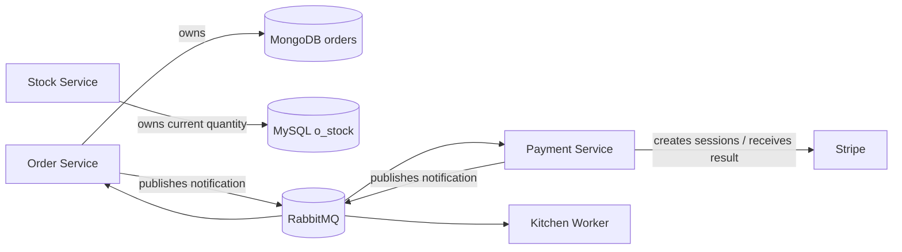
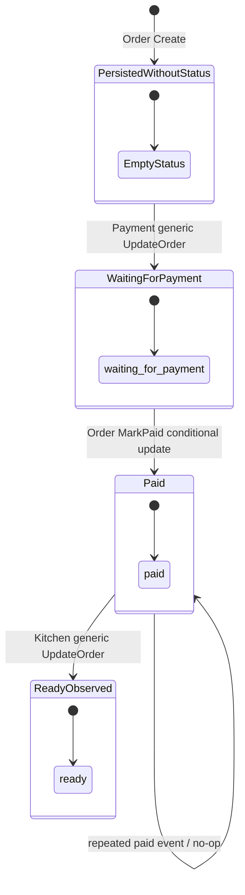

# 数据所有权与状态模型

[返回文档地图](../README.md) · [核心业务流程](business-flow.md)

本文回答三个问题：每类业务数据由谁负责、事件承载什么语义、订单状态迁移在哪里被约束。
结论来自当前分支代码，而不是理想化领域模型。

## 1. 数据所有权



| 数据 | 当前写入者 | 当前读取者 | 权威与限制 |
|---|---|---|---|
| 订单 ID、客户 ID、状态、支付链接、商品快照 | Order | Order API、Order consumer、经 gRPC 的 Payment/Kitchen | MongoDB 是仓库内的持久化权威 |
| 商品当前库存数量 | Stock | Stock query | MySQL `o_stock` 是当前数量来源，但只读不扣减 |
| 商品支付 Price ID | Stripe Product API | Stock | 调用时动态读取，没有本地商品主数据表 |
| Checkout Session 与支付结果 | Stripe | Payment | Provider 是支付事实来源；本地没有支付交易表 |
| 创建/支付通知 | Order、Payment | Payment、Order、Kitchen | RabbitMQ 负责传递，不是业务状态权威 |
| 服务实例地址 | Order、Stock 注册到 Consul | gRPC client | 只用于运行时发现，不属于业务数据 |

### 1.1 为什么不存在全局事务

一笔流程会依次触及 MySQL、Stripe、MongoDB 和 RabbitMQ。它们没有共享事务管理器，代码也
没有实现两阶段提交。因此当前只能在每个系统内部获得局部原子性：

- MongoDB 单次条件更新可以原子判断并推进支付状态；
- MySQL 查询可以读取当前数量，但没有把数量变化纳入订单事务；
- RabbitMQ 的持久化消息与手动 ACK 管理 delivery，但不能和 MongoDB 提交组成原子动作；
- Stripe webhook 告知 Provider 状态，但本地接收与消息发布之间也不是同一事务。

正确性设计因此应围绕业务不变量、幂等、持久化事件记录和对账展开，而不是假设存在全局
ACID 事务。

## 2. Order 持久化模型

MongoDB model 当前保存：

| 字段 | 来源/用途 | 当前约束 |
|---|---|---|
| `_id` | MongoDB ObjectID；对外转换为订单 ID | `Get`、`MarkPaid` 和 `Update` 的主定位字段 |
| `id` | model 中存在，但创建时没有单独赋值 | 当前读取逻辑使用 `_id`，不依赖该字段 |
| `customer_id` | 创建订单请求 | 与 `_id` 一起隔离客户订单 |
| `status` | 创建时为空；后续 Payment/Order/Kitchen 更新 | 只有 `MarkPaid` 对旧状态做条件限制 |
| `payment_link` | Payment 创建 Stripe URL 后写入 | webhook event 可能再次以空值覆盖 |
| `items` | Stock 校验后返回的订单商品快照 | 不是实时库存，也不代表已预占 |

Order repository 暴露四类操作：

- `Create`：插入订单并返回 `_id`；
- `Get`：用 `_id + customer_id` 查询；
- `MarkPaid`：支付终态专用条件更新；
- `Update`：读取订单后，按调用者提供的对象写入状态与支付链接。

## 3. 当前真实状态模型

### 3.1 代码中显式定义的状态

Order domain 只定义两个常量：

```text
waiting_for_payment
paid
```

`Order.IsPaid()` 也只验证对象是否为 `paid`。当前不存在集中式 `CanTransitionTo`、版本字段或
完整状态枚举。

### 3.2 运行路径中观察到的状态



图中的 `ReadyObserved` 不是 domain 已正式建模的状态，而是 Kitchen 通过通用 gRPC 更新写入
的字符串 `ready`。同样，新订单落库时状态字段为空，直到 Payment 成功创建链接后才写成
`waiting_for_payment`。

因此更准确的结论是：当前只有 `waiting_for_payment -> paid` 是受持久化层约束且有测试的
领域迁移；其余箭头是代码当前发生的写入路径，不具有同等强度的状态机保证。

## 4. 专用 `MarkPaid` 与通用 `UpdateOrder`

| 维度 | `MarkPaid` | `UpdateOrder` |
|---|---|---|
| 使用者 | Order 的 `order.paid` consumer | Payment、Kitchen gRPC 调用 |
| 目标 | 只推进支付终态 | 写入调用方提供的状态与支付链接 |
| 数据库条件 | `_id + customer_id + status=waiting_for_payment` | `_id + customer_id` |
| 并发冲突检测 | 条件不命中后读取并分类 | 无版本号或旧状态条件 |
| 重复操作 | 当前已是 `paid` 时成功 no-op | 可能重复覆盖相同或更新后的字段 |
| 非法状态 | 返回 `InvalidStatusTransitionError` | 没有统一迁移验证 |
| 自动化证据 | repository、command、consumer 测试 | 默认验证只确认编译，无并发语义测试 |

Mongo `Update` 调用了 `StartSession` 和 `StartTransaction`，但后续 `Get` 与 `UpdateOne` 继续
使用原始 `context.Context`，没有使用 `mongo.SessionContext` 执行操作。因此当前代码不能证明
这两个操作实际处在所启动的 transaction 内。即使补齐 session context，最终 `UpdateOne`
也没有把旧状态、版本或更新时间放进 filter，仍不能仅靠“先读后写”防止并发覆盖。

## 5. 库存数据模型

MySQL 初始化脚本只创建 `o_stock`：

```text
id, product_id, quantity, created_at, updated_at
```

当前 `CheckIfItemsInStock`：

1. 批量读取请求商品的 `quantity`；
2. 把商品 ID 映射到当前数量；
3. 请求数量大于当前数量时返回 `ExceedStockError`；
4. 数量足够时，从 Stripe Product API 取得 Price ID；
5. 返回用于创建订单的商品快照。

它没有写 MySQL，源码保留了“扣库存”的 TODO。`GetItems` 虽然存在 gRPC 契约和 query
handler，但 MySQL repository 对应方法仍为 `panic("implement me")`。

因此 `quantity` 目前只能解释为“检查时读取到的可用数量”，不能解释为已售、已锁、在途、
预占或最终库存。

## 6. 事件语义

### 6.1 `order.create`

| 属性 | 当前实现 |
|---|---|
| 发布者 | Order `CreateOrder` handler |
| 消费者 | Payment consumer |
| 消息体 | 创建后完整 Order JSON |
| 传输 | 发布到默认 exchange，以 `order.create` 为 routing key/queue name |
| 持久性 | `DeliveryMode=Persistent`，队列声明为 durable |
| 业务身份 | 没有独立 event ID；消息也未显式设置 `MessageId` |
| trace | 注入 OpenTelemetry propagation headers |

这条消息的业务含义是“订单记录已创建，请尝试建立支付会话”，不是“支付一定已创建”。

### 6.2 `order.paid`

| 属性 | 当前实现 |
|---|---|
| 发布者 | Payment Stripe webhook handler |
| 消费者 | Order consumer、Kitchen consumer |
| 消息体 | 从 Stripe Checkout Session metadata 还原的 Order-like JSON |
| 传输 | `order.paid` fanout exchange |
| 持久性 | `DeliveryMode=Persistent`；consumer queue 的生命周期配置并不完全一致 |
| 业务身份 | Stripe event ID 没有进入 payload/Inbox，`MessageId` 未显式设置 |
| trace | webhook 发布时注入 propagation headers，consumer 提取 |

这条消息当前同时承担两个意图：推进 Order 支付状态、触发 Kitchen 履约。由于 fanout
consumer 独立确认，一个 consumer 成功不代表另一个成功。

## 7. 数据一致性边界总结

| 边界 | 当前保证 | 当前不保证 |
|---|---|---|
| Order 单文档支付迁移 | 条件更新原子；重复 paid 为 no-op | Provider event 审计、所有状态迁移合法性 |
| Order 与消息 | 消息可持久化、手动确认 | MongoDB commit 与 publish 原子性 |
| Stock 与 Order | 创建前同步检查当前数量 | 预占、扣减、超卖防护、订单取消释放 |
| Stripe 与本地订单 | 签名 webhook 能触发本地事件 | publish 失败恢复、对账、退款和争议 |
| Kitchen 与 Order | 成功后能用 gRPC 写入 `ready` | 履约副作用幂等、严格 paid 前置条件 |

下一步阅读[可靠性模型](reliability.md)，可以看到这些边界怎样转化为明确的不变量和失败
窗口；[架构演进路线](evolution.md)则说明补齐顺序。
