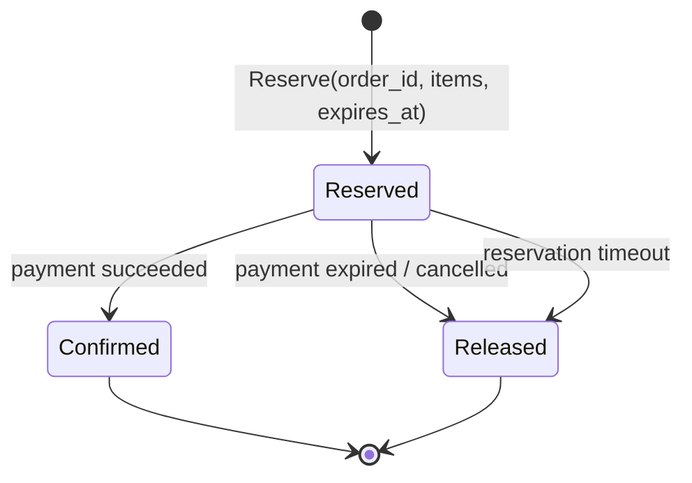

# 架构演进路线

[返回文档地图](../README.md) · [可靠性模型](reliability.md)

本文全部内容都是**演进方案，当前尚未实现**。路线按“先关闭已知失败窗口，再增加系统
复杂度”的顺序组织，不以堆叠中间件为目标。每个阶段必须同时交付实现、故障测试和可观测
证据，才可以更新[能力矩阵](../project-evidence.md)。

## 1. 演进原则

1. **数据库约束优先于进程内判断**：竞争条件要落在条件更新、唯一索引或事务边界上；
2. **事件身份与业务身份分离**：`event_id` 识别 delivery 代表的事件，`order_id` 识别聚合；
3. **持久化意图先于异步发布**：必须能够从存储恢复“还有什么消息需要发”；
4. **Consumer 先记录再产生不可逆副作用**：Inbox 去重需要和业务写入处在清晰事务边界；
5. **补偿不是回滚时间**：支付、库存、履约只能通过新业务动作修正，不能假装外部动作未发生；
6. **对账是最后防线，不是主流程替代品**；
7. **Redis 不承担最终正确性**：可用于加速、租约或限流，但数据库状态和事件日志仍是权威。

## 2. 阶段总览


阶段可以在一个仓库中逐步完成，不需要一开始就拆出完整平台或引入大型 workflow engine。

## 3. P0：修复 Consumer 控制流和错误传播

### 要解决的问题

- Payment 对解析/处理错误 NACK 后继续 ACK；
- Kitchen 解析失败可能 NACK 两次；
- `CreatePayment` 吞掉 Order gRPC 更新错误；
- webhook 忽略 RabbitMQ publish error 后返回 200；
- ACK、NACK 和 publish error 缺少结构化分类。

### 方案

- 为每个 consumer 规定一个 terminal outcome：`ACK`、`RETRY_PUBLISHED_AND_NACKED`、
  `DEAD_LETTERED_AND_NACKED` 或 `NACKED_INVALID`；
- 错误路径立即 return，确认操作集中在一处；
- `CreatePayment` 原样返回 Order gRPC error；
- webhook 只有在支付结果被可靠持久化后才返回 2xx；在 P1/P2 落地前，publish 失败至少返回
  可重试的 5xx；
- 把 transient、permanent、invalid-message 错误分开，避免所有错误使用同一重试策略。

### 不解决什么

P0 只让错误语义可预测，仍不能消除 DB/MQ 双写，也不能防止 Stripe Checkout 或 Kitchen
副作用重复。

### 验收证据

- Payment、Order、Kitchen 每条 consumer 分支都有 ACK/NACK 调用次数测试；
- Order gRPC 失败会到达 retry 分支；
- RabbitMQ publish 失败时 webhook 返回非 2xx；
- 无 live Broker 的单元测试能复现所有分支。

## 4. P1：稳定事件契约与持久化 Inbox

### 要解决的问题

当前 `order.paid` 只有 Order-like payload，没有 Stripe event ID，不能识别一次 Provider 事件，
也无法对其处理历史进行审计。

### 建议事件信封

```json
{
  "event_id": "internal-uuid",
  "event_type": "payment.succeeded",
  "schema_version": 1,
  "occurred_at": "RFC3339 timestamp",
  "producer": "payment",
  "provider": "stripe",
  "provider_event_id": "evt_...",
  "aggregate_type": "order",
  "aggregate_id": "order-id",
  "customer_id": "customer-id",
  "payload": {
    "payment_session_id": "cs_...",
    "payment_status": "paid"
  },
  "trace": {}
}
```

支付链接应从本地订单/支付记录读取，不应依赖 webhook metadata 中的旧快照覆盖。

### Inbox 方案

每个需要事件级去重的 consumer 拥有自己的 Inbox，唯一键至少包含
`consumer_name + event_id`。Order 处理支付事件时，在同一个本地事务中：

1. 插入 Inbox 记录；
2. 对订单执行受限状态迁移；
3. 提交；
4. 提交成功后 ACK。

唯一键冲突表示同一 consumer 已经处理过该事件，可以安全 ACK。不同 consumer 拥有独立
记录，因此 Order 完成不会误认为 Kitchen 也已完成。

### 存储选择

- Order Inbox 可以与 Order 数据同属 MongoDB；若使用多文档 transaction，本地 Mongo 和
  部署环境必须配置 replica set；
- 对当前支付迁移，也可把已处理 event ID 嵌入订单文档并用单文档条件更新，但要定义数组
  增长、归档和查询成本；
- Payment webhook 接收记录应进入 Payment 自己拥有的持久化存储，不能让 Payment 直接写
  Order 数据库来“省一次调用”。

### 不解决什么

Inbox 解决消费去重，不自动解决 producer 在业务提交后没发出消息的问题。那个窗口属于
P2 Outbox。

### 验收证据

- 同一 `provider_event_id` 顺序/并发到达只产生一个 Payment 接收记录；
- 同一 `event_id` 顺序/并发消费只提交一次业务副作用；
- 在“业务提交后、ACK 前”注入 crash，重启后重复 delivery 被 Inbox 吸收；
- schema version 未知时进入明确的不可重试错误路径，而不是静默解析。

## 5. P2：Transactional Outbox

### 要解决的问题

- Order 创建成功但 `order.create` 没发出；
- webhook 已可靠记录但 `payment.succeeded` 没发出；
- 直接 publish 缺少 publisher confirm、重试状态和可查询积压。

### Order Outbox 方案

当前 Order 使用 MongoDB。第一版可优先采用**聚合内嵌 Outbox**：创建订单时在同一个文档中
写入订单数据和 `pending_events`，利用单文档原子性避免依赖多文档事务。Publisher worker：

1. 查询未发布事件；
2. 以稳定 `event_id` 发布；
3. 等待 publisher confirm；
4. 条件标记 `published_at`；
5. 失败时记录 attempt、last_error 和 next_attempt_at。

如果后续采用独立 Outbox collection，则必须在 replica set 上使用 MongoDB transaction，
确保订单和 Outbox 两个文档一起提交。

### Payment Outbox 方案

Payment webhook 先将 Provider event 与待发布事件写入 Payment-owned store，再返回 2xx。
独立 worker 从 Outbox 发布 `payment.succeeded`。这样 RabbitMQ 短暂不可用时，Stripe 已支付
事实仍有本地持久化恢复点。

### 为什么发布仍可能重复

Publisher 可能在 Broker 确认后、标记 `published_at` 前退出，所以重启后仍会重复发布。
Outbox 解决“不能漏发”，不提供 exactly-once；P1 Inbox 和业务幂等负责吸收重复。

### 验收证据

- 在业务提交前、提交后、publish 前、Broker confirm 后分别注入 crash；
- 提交前失败不产生业务记录，提交后失败最终能从 Outbox 恢复发布；
- 重复发布具有同一 `event_id`，consumer 只提交一次业务效果；
- Outbox backlog、最老待发布年龄、attempt count 有指标和告警。

## 6. P3：库存预占、确认与释放

### 要解决的问题

当前 check-only 不能阻止两个订单同时看到同一份库存，也无法处理支付超时和取消。

### 建议状态模型



MySQL 中建议区分：

- `stock_balance(product_id, on_hand, reserved, version)`；
- `stock_reservation(order_id, product_id, quantity, status, expires_at)`；
- 唯一键 `(order_id, product_id)` 使 Reserve/Confirm/Release 可重入。

Reserve 在一个 MySQL transaction 中执行条件更新：只有
`on_hand - reserved >= requested` 才增加 `reserved` 并插入 reservation。Confirm 将 reserved
转为最终扣减，Release 只减少 reserved。每个命令都根据 reservation 当前状态决定“首次
变化、成功 no-op、非法迁移”。

### 与支付流程的关系

建议顺序：

1. 创建订单意图；
2. Stock 预占成功；
3. 创建支付会话并进入 `waiting_for_payment`；
4. 支付成功后确认库存；
5. 支付创建失败、支付过期或订单取消时释放；
6. 定时任务回收超过 `expires_at` 且仍为 Reserved 的记录。

### 不解决什么

预占状态机本身不保证跨 Order、Stock、Payment 的所有步骤一次成功。每个命令仍需幂等，
跨服务进度由 P4 的流程状态和 P5 对账兜底。

### 验收证据

- 并发 Reserve 总量永远不超过可用库存；
- 同一订单重复 Reserve/Confirm/Release 不重复改变数量；
- Confirm 与 Release 竞争时只有一个合法终态；
- crash 后超时任务可以恢复并释放遗留 reservation；
- 属性测试持续检查 `on_hand >= 0`、`reserved >= 0` 和 reservation 汇总一致性。

## 7. P4：显式订单流程与补偿

### 要解决的问题

当前状态字段把支付和履约混在一个字符串里，通用 `UpdateOrder` 可以直接覆盖任意状态，无法
回答“流程卡在哪一步、下一动作是什么、补偿是否完成”。

### 方案

- 用显式 command 取代通用 `UpdateOrder`：`AttachPaymentSession`、`MarkPaid`、
  `MarkInventoryConfirmed`、`MarkReady`、`CancelOrder`；
- 每个 command 定义旧状态、目标状态、幂等结果和非法迁移；
- Order 保存流程版本或 revision，条件更新包含旧状态/revision；
- 记录每一步的 correlation ID、attempt 和 last error；
- 支付已成功但库存确认失败时，不“回滚支付”，而是进入需要退款/人工处理的明确状态并发出
  新命令；
- 只有当正向动作、补偿动作及其持久化状态都完成后，才把这套流程称为 Saga。

初期可以使用事件 choreography 和 Order 中的显式 process state，不必立即引入 workflow
engine。只有在超时、等待、人工节点和分支数量显著增加时，再评估 Temporal 等引擎。

### 验收证据

- 状态转移表覆盖所有 command，非法迁移测试完备；
- 每个外部步骤失败后都有可查询的 pending/failed 状态；
- 重放同一 command 不会重复扣库存、退款或履约；
- 从任意持久化中间状态重启都能继续，而不是依赖进程内 goroutine。

## 8. P5：对账与自动修复

### 要解决的问题

即使 Inbox/Outbox 正确，外部 Provider、人工操作、长期故障和代码缺陷仍可能造成状态分叉。

### 对账集合

| 对账任务 | 比较对象 | 发现差异后的动作 |
|---|---|---|
| Payment reconciliation | Stripe paid/refunded/disputed vs Payment event ledger/Order | 生成缺失事件、退款任务或人工工单 |
| Outbox reconciliation | 未发布/长期重试事件 vs Broker publish result | 重试、隔离 poison event、告警 |
| Inventory reconciliation | stock balance vs reservation 汇总/确认记录 | 重算、冻结异常商品、人工审核 |
| Order process reconciliation | Order 流程状态 vs Payment/Stock/Kitchen step | 重发幂等 command 或转人工 |
| DLQ reconciliation | DLQ message vs 当前业务状态 | 判定已完成、可重放、不可重试或需修复数据 |

所有自动修复动作必须自身幂等，并留下 reason、before/after、operator/job ID 和时间。不能通过
“直接改数据库”制造第二套不可审计流程。

### 验收证据

- 使用构造的不一致样本验证每类差异能被发现；
- dry-run 只报告，不修改；apply 模式重复执行结果相同；
- 重放不会绕过正常 command 的状态约束；
- 对账延迟、差异数量、修复成功率和转人工数量可观测。

## 9. P6：故障注入与可量化证据

### 建议实验矩阵

| 注入点 | 预期 |
|---|---|
| Mongo commit 前退出 | 无订单、无 Outbox event |
| Mongo commit 后/Outbox publish 前退出 | worker 重启后发布 |
| Broker confirm 后/Outbox 标记前退出 | 同 event ID 重发，Inbox 吸收 |
| Order commit 后/ACK 前断开 | Broker 重投，订单保持单次迁移 |
| Stripe webhook 持久化前失败 | 返回非 2xx，Provider 可重试 |
| Payment event 持久化后/publish 前退出 | Payment Outbox 恢复发布 |
| Reserve 成功后服务退出 | reservation 保留，可继续或超时释放 |
| Confirm/Release 并发 | 只有一个合法终态 |
| Kitchen 副作用完成后/ACK 前退出 | 履约 Inbox/记录阻止重复执行 |

### 需要形成的证据

- 自动化 integration tests 或可重复 chaos scripts；
- 每个注入点的数据库最终状态、消息次数和业务副作用次数断言；
- Outbox/Inbox/DLQ/reservation 指标；
- 基于测试环境数据的恢复时间分布。

在这些实验完成前，不应给出 QPS、可用性、零丢失或恢复时间承诺。压测指标也必须附带硬件、
数据规模、请求模型和依赖配置，才能作为作品证据。

## 10. 推荐的作品集实施切片

为了保持项目简单且每一步都能讲清楚，建议按下面四个可独立评审的切片推进：

1. **Consumer correctness**：完成 P0，统一确认状态测试；
2. **Reliable payment event**：完成 Provider event ledger、Payment Outbox、Order Inbox，并加入
   webhook crash-point test；
3. **Reliable order creation**：完成 Order Outbox 和 publisher worker；
4. **Inventory reservation**：完成 MySQL reservation state machine 与并发测试。

P4-P6 可以先以文档和实验接口保留，只有前三个可靠性切片稳定后再扩展。这样既能展示技术
思考，也避免把一个作品仓库做成无法验证的“大而全平台”。

