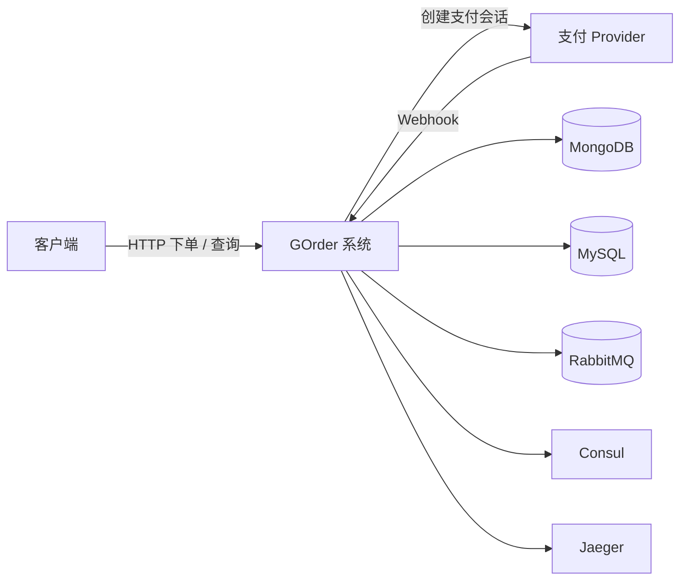
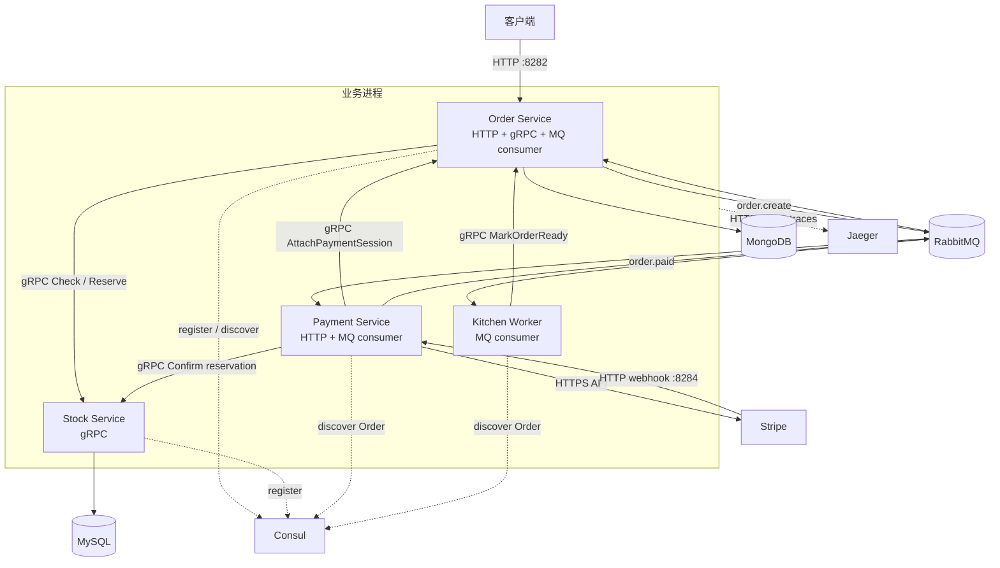

# 系统架构总览

[返回文档地图](../README.md)

本文给出 GOrder 当前分支的系统边界、服务职责、通信方式和运行拓扑。它描述的是仓库中能够
定位到的实现，不把尚未落地的可靠性方案画进“现状架构”。

## 1. 系统定位与边界

GOrder 把一条简化交易流程拆成四个进程：Order 管理订单，Stock 检查并预占商品库存，Payment
创建支付链接并接收支付平台回调，Kitchen 在支付后模拟履约。服务之间同时使用同步 gRPC
和异步 RabbitMQ；订单与库存分别写入 MongoDB 和 MySQL。

系统内边界包括：

- 接收客户创建、查询订单的请求；
- 查询并预占库存，组装订单商品信息；
- 创建外部支付链接并处理支付成功 webhook；
- 把支付成功推进为订单状态变化，并触发模拟履约；
- 通过 Consul 发现 Order 和 Stock 的 gRPC 地址；
- 通过 OpenTelemetry instrumentation 向 Jaeger 导出 HTTP/gRPC trace。

当前明确不在闭环内：账户、购物车、商品后台、退款、真实发货、到期自动释放、Outbox、通用
Inbox、Provider 对账、鉴权、多环境部署和容量治理。预占细节见[库存预占边界](inventory-reservation.md)。

## 2. 服务与组件

### 2.1 业务进程职责

| 进程 | 当前职责 | 入口 | 下游依赖 | 状态存储 |
|---|---|---|---|---|
| Order Service | 创建、查询订单；通过显式命令约束主流程状态迁移 | HTTP、gRPC、`order.paid` consumer | Stock gRPC、RabbitMQ、MongoDB | MongoDB `order.order` collection |
| Stock Service | 查询商品、原子预占/确认/释放库存；获取 Stripe Price ID | gRPC | MySQL、Stripe API | MySQL `o_stock` 与 reservation tables |
| Payment Service | 消费订单创建事件；创建支付链接；回写支付链接；验证 Stripe webhook 并发布支付结果 | `order.create` consumer、HTTP webhook | Order gRPC、Stripe、RabbitMQ | 没有本地业务数据库 |
| Kitchen Worker | 消费已支付事件；等待模拟处理；把订单更新为 `ready` | `order.paid` consumer | Order gRPC、RabbitMQ | 没有本地业务数据库 |

`internal/common` 不是独立服务。它提供配置、RabbitMQ helper、gRPC client/server、Consul、
日志 middleware、OpenTelemetry tracing 和 application decorator 等共享能力。

### 2.2 对外与内部契约

| 类型 | 调用方 → 被调用方 | 当前契约 |
|---|---|---|
| HTTP | Client → Order | 创建订单、按客户和订单 ID 查询订单 |
| HTTP | Stripe → Payment | Stripe webhook；处理 `checkout.session.completed` |
| gRPC | Order → Stock | `CheckIfItemsInStock`、`Reserve`、`GetReservation`；`GetItems` 显式返回 Unimplemented |
| gRPC | Payment → Order | `AttachPaymentSession` 挂接支付链接并推进预期状态 |
| gRPC | Kitchen → Order | `MarkOrderReady` 从已支付状态推进 `ready` |
| RabbitMQ | Order → Payment | `order.create` |
| RabbitMQ | Payment → Order/Kitchen | `order.paid` |

这里存在一个重要边界：事件表示“发生了需要其他服务处理的事情”，MongoDB/MySQL 中的业务
记录才是当前持久化状态。RabbitMQ 不是订单或库存的最终权威。

## 3. 同步与异步协作

| 选择 | 当前使用位置 | 获得的特性 | 当前代价 |
|---|---|---|---|
| 同步 HTTP | 客户下单/查询、Stripe webhook | 请求方立即得到处理结果 | 依赖下游响应；缺少统一鉴权和超时治理 |
| 同步 gRPC | Order 查 Stock；Payment/Kitchen 提交显式 Order 命令 | 接口由 protobuf 定义，调用语义与状态前置条件明确 | 运行时依赖 Consul 和目标进程；跨服务失败仍需重试/恢复 |
| 异步 RabbitMQ | 创建订单后启动支付；支付后推进订单和履约 | 解耦调用时间，支持 Broker 重投和重试 | 至少一次投递要求 consumer 幂等；数据库与发布之间没有原子事务 |

当前实现不是纯事件驱动架构：支付和履约仍通过同步 gRPC 回写 Order；也不是单体系统，因为
服务以独立 Go module 和进程运行。更准确的描述是“同步 RPC 与异步事件混合的微服务实验
骨架”。

## 4. 数据与控制边界

| 数据/控制 | 当前权威 | 说明 |
|---|---|---|
| 订单主体、状态、支付链接、商品快照 | Order / MongoDB | 由 Order repository 读写 |
| 可用库存与预占状态 | Stock / MySQL | Reserve 原子扣可用数量；Confirm 不重复扣减；Release 恢复一次 |
| 支付会话和支付结果 | Stripe | Payment 通过 API 创建会话，通过签名 webhook 接收结果 |
| 跨服务通知 | RabbitMQ | 使用持久化消息和手动 ACK；不等于业务状态本身 |
| gRPC 服务地址 | Consul | Order、Stock 注册；调用方发现它们的地址 |

更详细的状态语义见[数据所有权与状态模型](data-and-state.md)，端到端步骤见
[核心业务流程](business-flow.md)。

## 5. 运行拓扑

### 5.1 Docker Compose 当前负责什么

根目录 `docker-compose.yml` 只编排基础设施：

| 组件 | 本地端口 | 当前用途 |
|---|---:|---|
| Consul | `8500`、`8600/udp` | 服务注册、健康 TTL 和发现 |
| RabbitMQ | `5672`、管理台 `15672` | 业务事件、重试和 DLQ |
| Jaeger | `16686`、`14268`、`4317/4318` 等 | trace 接收和查询 UI |
| MongoDB | `27017` | Order 持久化 |
| mongo-express | `8082` | 本地查看 MongoDB |
| MySQL | 宿主机 `3307` → 容器 `3306` | Stock 持久化 |
| Prometheus | `9090` | 监控基础设施占位 |
| Grafana | `3000` | 可视化基础设施占位 |

Compose **不包含** Order、Stock、Payment、Kitchen 业务容器，也不包含 Redis。执行
`docker compose up -d` 只会启动依赖；业务进程仍需在各 module 中分别运行。

### 5.2 默认本地进程

| 进程 | 默认监听/行为 |
|---|---|
| Order | HTTP `127.0.0.1:8282`；gRPC `127.0.0.1:5002`；注册 Consul；消费 `order.paid` |
| Stock | gRPC `127.0.0.1:5003`；注册 Consul |
| Payment | HTTP `127.0.0.1:8284`；消费 `order.create`；通过 Consul 发现 Order |
| Kitchen | 无 HTTP/gRPC server；消费 `order.paid`；通过 Consul 发现 Order |

这些地址来自 `internal/common/config/global.yaml`，属于本地开发默认值，不是部署清单。

## 6. 服务发现、Tracing 与 Metrics 的真实成熟度

### Consul：已接入，但治理能力有限

- Order 和 Stock 启动时注册 gRPC 地址，周期性刷新 TTL；
- Payment、Kitchen 通过 Consul 发现 Order，Order 通过 Consul 发现 Stock；
- 多实例地址使用随机选择，没有负载统计、熔断、退避重连或 zone-aware 策略；
- `waitFor*GrpcClient` 先探测配置里的固定地址，再进行 Consul 发现，这使本地配置仍参与启动
  前置条件。

### Tracing：HTTP/gRPC 骨架已接入

- 各业务进程初始化 OpenTelemetry `TracerProvider` 并向 Jaeger collector 导出；
- Gin 使用 `otelgin`，gRPC client/server 使用 `otelgrpc`；
- 配置了 W3C Trace Context、Baggage 和 B3 propagation；
- 当前文档不宣称 RabbitMQ 消息已经完整传播 trace context，也没有给出 trace 完整率指标。

### Metrics：基础设施存在，应用指标尚未实现

- Compose 中有 Prometheus 和 Grafana；
- application handler 注入的 `TodoMetrics` 的 `Inc` 为空实现；
- Prometheus 配置没有业务服务 scrape target；
- 因此只能称为监控占位，不能称为已具备可用的业务指标、告警或 dashboard。

### Redis：当前不存在

当前分支的 Compose、配置和核心业务代码均没有 Redis 组件或依赖。Redis 锁、缓存、限流或
事件缓冲都不是现状能力；如果未来引入，也不能替代数据库条件更新、唯一约束和持久化消息
记录等最终正确性边界。

## 7. 架构优点与当前约束

### 当前能够展示的设计点

- 以服务所有权拆分订单、库存、支付和履约；
- 对外 HTTP、内部 gRPC、跨服务事件三类边界清晰；
- 主流程三条状态迁移通过 repository 原子条件更新收敛，而不是只在 consumer 内存中判断；
- 核心支付重投实验不依赖真实 MongoDB、RabbitMQ 或 Stripe，能够离线复现；
- 把未实现能力保留为显式缺口，便于针对故障窗口逐步演进。

### 阅读其余文档时必须保留的约束

- 显式订单迁移与 consumer correctness 有当前自动化证据，不能外推到所有外部副作用；
- 通用 `UpdateOrder` 已删除，但取消、退款、库存确认等完整流程状态仍未建模；
- Stock 已有预占状态机，但缺少 Provider 核查后的自动到期释放；
- DB 写入和 RabbitMQ 发布之间没有 Outbox；
- 当前项目是工程重建和设计验证，不是生产系统源码或生产就绪模板。

下一步可阅读[核心业务流程](business-flow.md)了解调用顺序，或直接进入
[可靠性模型](reliability.md)分析失败窗口。
