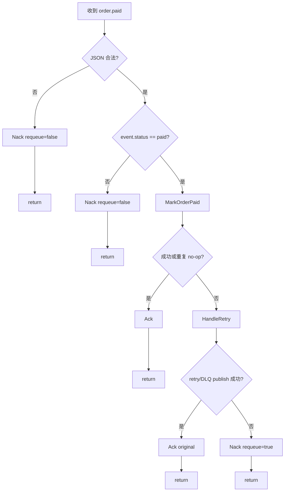
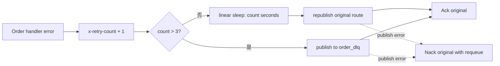

# 可靠性模型

[返回文档地图](../README.md) · [核心业务流程](business-flow.md) ·
[数据所有权与状态模型](data-and-state.md)

本文不以“消息不重复”作为目标，而是逐层回答：重复、延迟、乱序、局部失败发生时，哪些业务
不变量仍然成立，哪些失败需要后续恢复。文中“保证”只限于明确列出的代码和测试范围。

## 1. 可靠性分层

GOrder 当前链路包含四个不同层次，不能用一个“幂等”概念全部替代：

| 层次 | 要回答的问题 | 当前状态 |
|---|---|---|
| Delivery | 一条 RabbitMQ delivery 最终 ACK、NACK 还是重投？ | Payment、Order、Kitchen 已验证单一确认终态 |
| Event | 同一个业务事件怎样被识别？ | 没有稳定 event ID、Provider event ID 或持久化 Inbox |
| State transition | 重复事件会不会把业务状态重复推进或覆盖？ | `waiting_for_payment -> paid` 已用条件更新闭环 |
| Side effect | 支付会话、通知、履约等外部动作会不会重复？ | 当前没有通用保护，只验证了订单支付终态 |

因此，当前可以说“订单支付终态迁移幂等”，不能说“整个系统 exactly-once”或“所有消息都
幂等”。RabbitMQ 的至少一次投递仍然存在，设计目标是让重复 delivery 对特定业务不变量无害。

## 2. 当前已验证的不变量

### 2.1 支付终态只能首次迁移一次

**不变量**

```text
waiting_for_payment --first paid event--> paid
paid                --replayed paid event--> paid
other status         --paid event--> rejected
```

**机制**

MongoDB `UpdateOne` 的 filter 同时包含：

```text
_id = order_id
customer_id = customer_id
status = waiting_for_payment
```

只有 `ModifiedCount == 1` 表示当前调用完成真实迁移。没有修改时再读取当前订单：已经是
`paid` 返回 `changed=false, nil`；不存在或属于另一客户返回 not found；其他状态返回非法
迁移。

**证据**

- Mongo mock test 验证更新 filter 包含订单、客户和旧状态；
- 内存 repository test 验证首次变化、顺序重放、错误客户、错误状态；
- 16 个 goroutine 并发调用时只有一个 `changed=true`，该包在 race detector 下运行；
- command test 验证 event 必须声明 `paid`。

**剩余风险**

- event 没有 Provider event ID，无法区分“同一 webhook 重投”和“不同支付事件”；
- 只保护 Order 状态与支付链接字段，不保护未来新增的积分、通知、账务等副作用；
- webhook 常携带空支付链接；`MarkPaid` 已在空值时保留本地链接，但非空旧快照仍可能覆盖；
- 通用 `UpdateOrder` 不受这条状态迁移规则保护。

### 2.2 客户与订单共同限制更新目标

**不变量**：事件中的订单 ID 不能单独越权更新其他客户订单。

**机制**：`MarkPaid` 的条件同时包含 `_id` 和 `customer_id`，未命中后 `Get` 也使用同样组合。

**证据**：repository tests 覆盖错误客户与缺失订单，两者均不修改状态。

**剩余风险**：这只是持久化查询边界，不等于 HTTP/gRPC 已具备认证授权；当前 API 没有完整
身份体系，调用方仍可提交任意客户 ID。

### 2.3 Consumer 的确认路径互斥

**不变量**：对同一 delivery，Payment、Order、Kitchen 当前函数路径最多选择一个确认终态。



**证据**：三个 consumer 的 tests 分别断言成功、畸形消息、handler/downstream 错误、retry
publish 成功与失败；所有覆盖路径的 ACK/NACK 调用总数都为 1。Order 验证非 `paid` 消息
不会调用 handler/retry；Kitchen 还验证该消息不会触发 cook、gRPC 或 retry。

**剩余风险**：

- ACK/NACK 返回错误均被忽略，连接异常时最终 Broker 状态由 AMQP 连接决定；
- retry publish 使用 `mandatory=false` 且没有 publisher confirms，helper 返回 nil 不是 Broker
  已持久化替代消息的端到端证明；
- retry publish 失败后 requeue 原消息，能避免当前 consumer 主动丢弃唯一副本，但永久故障
  可能造成重复投递与队列压力；
- Kitchen 的 delivery 确认互斥不等于履约副作用幂等，`cook` 后崩溃仍可能重复执行。

## 3. RabbitMQ 重试与 DLQ 的实际语义

### 3.1 当前代码路径

`broker.HandleRetry` 实现的是应用层重新发布，不是 RabbitMQ queue policy 驱动的自动重试：

1. 从 header 读取 `x-retry-count`；缺失或类型不是 `int64` 时按 0 处理；
2. 计数加一并写回 header；
3. 未超过 `max-retry-count=3` 时，在当前 consumer goroutine 中 sleep `retryCount` 秒；
4. 以原 `Exchange` 和 `RoutingKey` 重新发布持久化消息；
5. 超过上限时，通过默认 exchange 以 `order_dlq` 为 routing key 发布到同名 DLQ；
6. helper 本身不确认原 delivery；调用方在重发/DLQ publish 成功时 ACK 原消息，在 helper
   返回错误时 `Nack(requeue=true)`。



### 3.2 能力边界

当前机制能够表达有限次数重试和终止队列，但不能推导出“消息一定不会丢”：

- 没有启用 publisher confirms，函数返回成功不构成端到端持久化证明；
- publish 使用 `mandatory=false`，无法路由的消息不一定回到应用；
- 重发失败时会 requeue 原 delivery；这避免立即丢失，但没有 poison-message 隔离或 requeue
  次数上限；
- sleep 阻塞当前消费循环，不是带调度时间的延迟队列；
- 没有 jitter，多个失败消息可能同步重试；
- 没有独立错误类别，永久性业务错误与瞬时基础设施错误可能走同一重试策略；
- `order_dlx` 和 `share_queue` 被声明，但当前 `HandleRetry` 的终止路径直接发布到
  `order_dlq`，不是通过 DLX policy 自动路由；
- 缺少 DLQ replay、人工处置、告警和积压指标。

## 4. Consumer 对比

| Consumer | 成功路径 | 解析失败 | handler/下游失败 | 当前判定 |
|---|---|---|---|---|
| Order `order.paid` | ACK 后 return | NACK 后 return | retry 成功 ACK；失败 requeue NACK | 单一终态已测试；订单支付迁移幂等 |
| Payment `order.create` | ACK 后 return | NACK 后 return | retry 成功 ACK；失败 requeue NACK | 单一终态与 gRPC error 传播已测试；Stripe 会话副作用不幂等 |
| Kitchen `order.paid` | ACK 后 return | NACK 后 return | retry 成功 ACK；失败 requeue NACK | 单一终态已测试；`cook` 副作用不幂等 |

这也是为什么可靠性改进首先应修复控制流，而不是直接引入更大的 Saga 框架：如果 delivery
本身没有单一终态，更高层的补偿协议也无法获得清晰输入。当前 P0 已完成这一步，但还没有
提供事件身份、持久化恢复点或不可逆副作用去重。

## 5. 失败窗口登记表

下表记录当前源码直接可见的风险。优先级是作品后续演进建议，不是生产事故结论。

| ID | 失败窗口 | 当前结果 | 影响 | 当前检测/恢复 | 建议优先级 |
|---|---|---|---|---|---|
| R1 | Order 写 Mongo 成功，发布 `order.create` 失败 | API 报错但订单已存在 | 支付流程未启动；客户端重试可能重复建单 | 无自动扫描或 Outbox | 高 |
| R2 | Stripe Checkout 已创建，Order gRPC 更新失败 | error 到达 Payment consumer 并进入 retry；重投可能再次创建 Checkout | Provider 出现多个会话，本地只记录后一次成功回写 | command/consumer 单元测试；无 Payment 幂等记录 | 高 |
| R3 | retry publish 返回 nil，但 Broker 未实际持久化/路由 | consumer ACK 原 delivery | 替代消息和原消息都不可恢复 | 无 publisher confirms，`mandatory=false` | 高 |
| R4 | Stripe webhook 收到已支付结果，RabbitMQ publish 返回 error | webhook 返回 HTTP 503，等待 Provider 重试 | 恢复依赖 Stripe 重试策略；没有本地 ledger/Outbox | webhook 单元测试；无 Provider 对账 | 高 |
| R5 | `order.paid` 没有 Provider event ID/Inbox | 不能持久化识别同一 Provider 事件 | 新增副作用后可能重复执行 | 订单终态只能保护一个状态字段集合 | 高 |
| R6 | webhook metadata 中 payment link 使用旧订单快照 | 空链接已被忽略；非空旧链接仍可能覆盖更新值 | 支付链接回退到较旧 session | repository 测试覆盖空值保留；事件模型仍待重构 | 中 |
| R7 | Payment/Kitchen 使用通用 `UpdateOrder` | filter 无旧状态/版本 | 并发写可能覆盖新状态或链接 | 无冲突指标或测试 | 高 |
| R8 | Stock 只检查、不预占 | 检查后数量仍可被其他订单使用 | 无法建立“不超卖”不变量 | 无 reservation 数据 | 最高（若目标是真实交易） |
| R9 | Kitchen 在 ACK 前执行 `cook` | 重投会再次执行副作用 | 重复履约 | 无 Inbox/履约记录 | 高 |
| R10 | retry/DLQ republish 持续失败 | 原消息持续 requeue | 不会由当前调用主动丢弃，但可能形成热循环和队列压力 | 日志；无熔断、调度队列或告警 | 中 |
| R11 | Mongo 通用 `Update` 启动 session，但读写仍使用普通 context；本地 Mongo 还是 standalone | 操作没有证据表明处于 transaction 中；修正 context 后 standalone 也不支持该事务形态 | 并发覆盖或完整本地链路失败 | 默认离线测试不覆盖 | 高 |
| R12 | metrics 是空实现，Prometheus 未抓取业务服务 | 失败只能靠日志发现 | 检测时间与定位质量差 | Jaeger/日志骨架 | 中 |

## 6. 一致性语义总结

| 场景 | 当前一致性结论 |
|---|---|
| 单个订单的首次支付迁移 | MongoDB 条件更新范围内原子 |
| 重复 `order.paid` 更新订单终态 | 在已覆盖状态模型内幂等 |
| Order 与 RabbitMQ | 最终一致性意图，但没有 Outbox，可能永久分叉 |
| Stripe 与本地 Order | publish error 返回 503，但无本地 ledger/Outbox、confirms 和对账，仍只有最终一致性意图 |
| Stock 与 Order | 只有时间点检查，不存在库存一致性闭环 |
| Kitchen 与 Order | 至少一次触发意图，副作用未去重 |

“最终一致”只有在系统具备持续重试、持久化待办或对账修复时才是完整承诺。对 R1、R2、R4、
R8 等场景，当前没有自动恢复路径，因此这里只能称为“最终一致性意图”。

## 7. 现有验证范围

默认命令：

```bash
make verify
```

它验证所有 module 能编译，并对支付重投涉及的 Order 包运行 `-race`。当前没有验证：

- 真实 RabbitMQ 断连、redelivery、publisher confirms 或 DLQ replay；
- MongoDB 与 RabbitMQ 之间的 crash point；
- 真实 Stripe webhook 重放与 Provider 查询对账；离线测试已覆盖合法测试签名、非法签名和
  RabbitMQ publish 返回 error；
- MySQL 并发预占；
- Kitchen 重复副作用；
- 完整业务服务从下单到履约的自动化链路。

Consumer 控制流与 webhook 发布反馈的复现命令见
[Consumer correctness 实验](../experiments/consumer-correctness.md)。

下一阶段应按[架构演进路线](evolution.md)逐个把高优先级失败窗口转化为可重复的故障注入
测试，而不是直接宣称“生产级高可用”。
